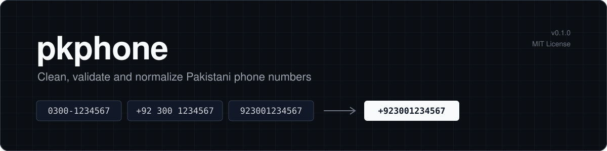
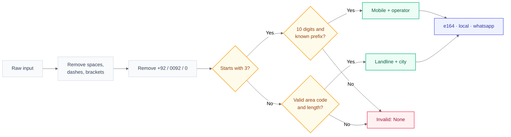
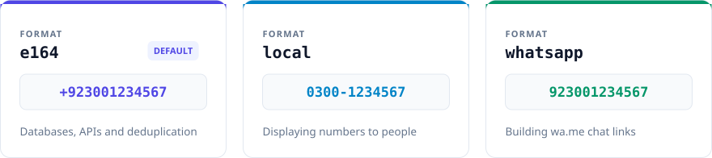
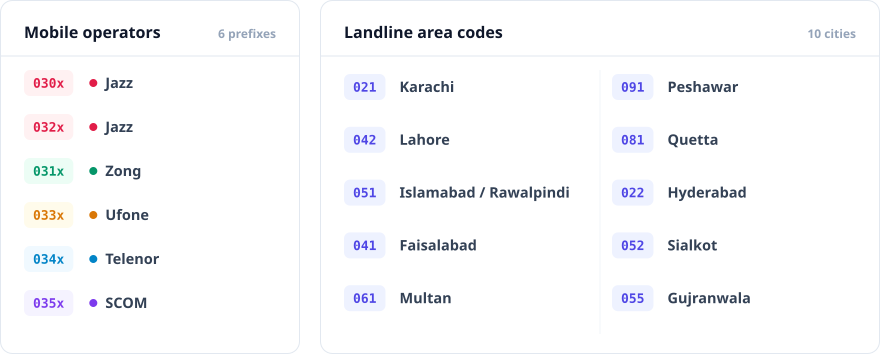
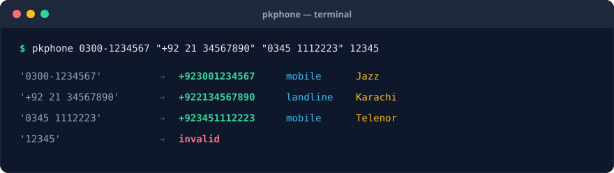
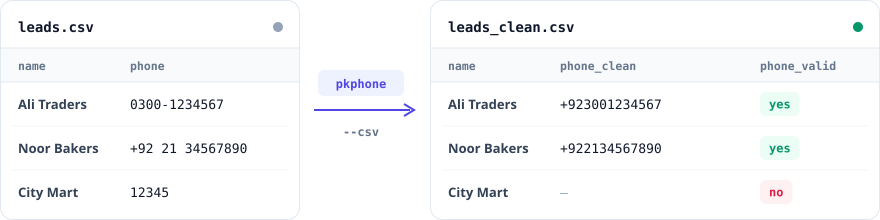
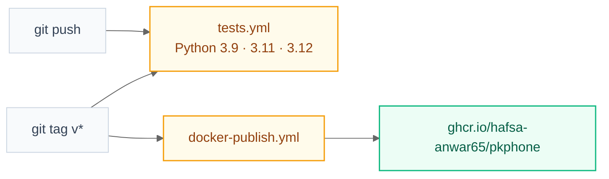

<p align="center">
  
</p>

<p align="center">
  <a href="https://github.com/Hafsa-Anwar65/pkphone/actions/workflows/tests.yml"></a>
  <a href="https://github.com/Hafsa-Anwar65/pkphone/actions/workflows/docker-publish.yml"></a>
  
  <a href="https://github.com/Hafsa-Anwar65/pkphone/pkgs/container/pkphone"></a>
  <a href="LICENSE"></a>
</p>

<p align="center">
  <a href="#overview">Overview</a> &nbsp;·&nbsp;
  <a href="#installation">Installation</a> &nbsp;·&nbsp;
  <a href="#quick-start">Quick Start</a> &nbsp;·&nbsp;
  <a href="#how-it-works">How It Works</a> &nbsp;·&nbsp;
  <a href="#command-line">CLI</a> &nbsp;·&nbsp;
  <a href="#docker">Docker</a> &nbsp;·&nbsp;
  <a href="#api-reference">API</a> &nbsp;·&nbsp;
  <a href="#license">License</a>
</p>

<br>

## Overview

The same Pakistani phone number is written in many different ways, especially in leads collected from Google Maps, Facebook, websites and CRM exports. This leads to duplicate records, broken WhatsApp links and invalid numbers in your data.

**pkphone** converts any common format into one consistent, validated number with a single function call.

<table>
  <tr>
    <th align="left" width="33%">Normalize</th>
    <th align="left" width="33%">Validate</th>
    <th align="left" width="33%">Identify</th>
  </tr>
  <tr>
    <td valign="top">Convert any common format to E.164, local or WhatsApp style.</td>
    <td valign="top">Reject numbers with a wrong length, prefix or area code.</td>
    <td valign="top">Detect mobile operator, or city for landline numbers.</td>
  </tr>
  <tr>
    <th align="left">Extract</th>
    <th align="left">Clean CSV files</th>
    <th align="left">Run anywhere</th>
  </tr>
  <tr>
    <td valign="top">Find every number inside free text, with duplicates removed.</td>
    <td valign="top">Add clean and valid columns to a whole CSV from the command line.</td>
    <td valign="top">Use as a Python library, a CLI tool or a Docker image.</td>
  </tr>
</table>

<br>

## Installation

| Method | Command |
| :--- | :--- |
| pip (from GitHub) | `pip install git+https://github.com/Hafsa-Anwar65/pkphone.git` |
| Pinned version | `pip install git+https://github.com/Hafsa-Anwar65/pkphone.git@v0.1.0` |
| requirements.txt | `pkphone @ git+https://github.com/Hafsa-Anwar65/pkphone.git@v0.1.0` |
| Docker | `docker pull ghcr.io/hafsa-anwar65/pkphone:latest` |

> [!NOTE]
> Requires Python 3.9 or newer. pkphone has no third-party dependencies.

<br>

## Quick Start

```python
from pkphone import parse, normalize, is_valid, extract_all

normalize("0300-1234567")              # '+923001234567'
normalize("+92 300 1234567", "local")  # '0300-1234567'
normalize("03001234567", "whatsapp")   # '923001234567'

p = parse("021-34567890")
p.kind, p.city                         # ('landline', 'Karachi')

parse("0345 1112223").operator         # 'Telenor'
is_valid("0390-1234567")               # False

extract_all("Call 0300-1234567 or office 021-34567890")
# [PhoneNumber(+923001234567), PhoneNumber(+922134567890)]
```

<br>

## How It Works



### Output formats

<p align="center"></p>

### Supported numbers

<p align="center"></p>

Other area codes are accepted with a general length check.

<br>

## Command Line

```bash
pkphone 0300-1234567 "+92 21 34567890" "0345 1112223" 12345
```

<p align="center"></p>

### Cleaning a CSV file

```bash
pkphone --csv leads.csv --column phone --out leads_clean.csv
```

<p align="center"></p>

| Option | Default | Description |
| :--- | :--- | :--- |
| `--format`, `-f` | `e164` | Output format: `e164`, `local` or `whatsapp` |
| `--csv` | | CSV file to clean |
| `--column` | `phone` | Column that holds the numbers |
| `--out` | stdout | Path of the output CSV |

<br>

## Docker

A Docker image is published to GitHub Packages automatically for every version tag.

<table>
  <tr>
    <th align="left">Linux / macOS</th>
  </tr>
  <tr>
    <td>

```bash
docker run --rm ghcr.io/hafsa-anwar65/pkphone 0300-1234567
docker run --rm -v "$PWD:/data" ghcr.io/hafsa-anwar65/pkphone --csv leads.csv --column phone
```

</td>
  </tr>
  <tr>
    <th align="left">Windows PowerShell</th>
  </tr>
  <tr>
    <td>

```powershell
docker run --rm ghcr.io/hafsa-anwar65/pkphone 0300-1234567
docker run --rm -v "${PWD}:/data" ghcr.io/hafsa-anwar65/pkphone --csv leads.csv --column phone
```

</td>
  </tr>
</table>

<br>

## API Reference

| Function or property | Returns | Description |
| :--- | :--- | :--- |
| `parse(raw)` | `PhoneNumber` or `None` | Parse and validate a number |
| `normalize(raw, fmt="e164")` | `str` or `None` | Return the number in the given format |
| `is_valid(raw)` | `bool` | `True` if the number is a valid Pakistani number |
| `extract_all(text)` | `list[PhoneNumber]` | All numbers found in the text, deduplicated |
| `PhoneNumber.kind` | `str` | `"mobile"` or `"landline"` |
| `PhoneNumber.operator` | `str` or `None` | Mobile operator |
| `PhoneNumber.city` | `str` or `None` | Landline city |
| `PhoneNumber.e164`, `.local`, `.whatsapp` | `str` | Formatted versions of the number |

<br>

## Development

```bash
git clone https://github.com/Hafsa-Anwar65/pkphone.git
cd pkphone
pip install -e . pytest
pytest
```

<details>
<summary><b>Project structure</b></summary>

```text
pkphone/
├── src/pkphone/
│   ├── __init__.py          Public API
│   ├── core.py              Parsing and validation
│   └── cli.py               Command line tool
├── tests/
│   └── test_core.py
├── .github/workflows/
│   ├── tests.yml            Runs tests on every push
│   └── docker-publish.yml   Publishes the Docker image on tags
├── assets/                README images
├── Dockerfile
├── pyproject.toml
├── LICENSE
└── README.md
```

</details>

### Release process



<br>

## Limitations

> [!IMPORTANT]
> The operator is detected from the number's original prefix. Numbers moved to another network through mobile number portability may show their original operator.

> [!NOTE]
> Landline lengths are checked strictly for the cities listed above. Other area codes receive a general length check.

<br>

## Contributing

Issues and pull requests are welcome. To add a city or operator, update the tables in `src/pkphone/core.py` and add a matching test in `tests/test_core.py`.

<br>

## License

pkphone is released under the **MIT License**. See the [LICENSE](LICENSE) file for the full text.

<table>
  <tr>
    <th align="left" width="33%">Permissions</th>
    <th align="left" width="33%">Conditions</th>
    <th align="left" width="33%">Limitations</th>
  </tr>
  <tr>
    <td valign="top">Commercial use<br>Modification<br>Distribution<br>Private use</td>
    <td valign="top">Include the copyright notice and license text in all copies</td>
    <td valign="top">No liability<br>No warranty</td>
  </tr>
</table>

<br>

---

<p align="center">
  <sub>Developed by <a href="https://github.com/Hafsa-Anwar65">Hafsa Anwar</a> · Copyright © 2026 · MIT License</sub>
</p>
