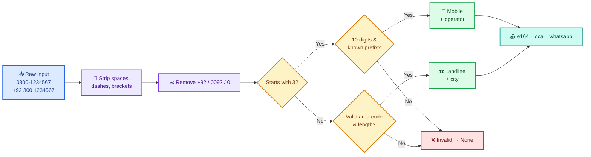
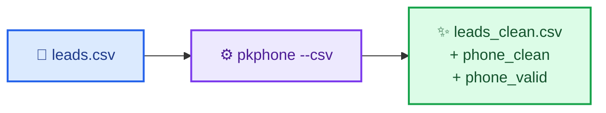
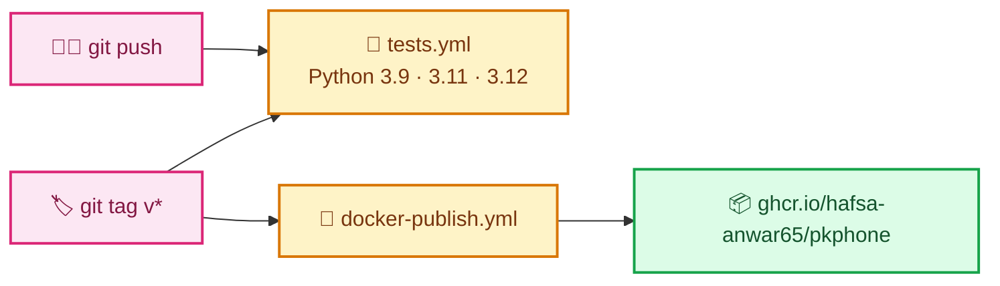

<div align="center">

# 📞 pkphone

### Clean, validate & normalize **Pakistani phone numbers** in one line

[](https://github.com/Hafsa-Anwar65/pkphone/actions/workflows/tests.yml)
[](https://github.com/Hafsa-Anwar65/pkphone/actions/workflows/docker-publish.yml)
[](https://www.python.org/)
[](https://github.com/Hafsa-Anwar65/pkphone/pkgs/container/pkphone)
[](LICENSE)
[](#)

**`0300-1234567` · `+92 300 1234567` · `923001234567` · `(0300) 123 4567`**
<br>
⬇️
<br>
**`+923001234567`**

[Features](#-features) • [Installation](#-installation) • [Quick Start](#-quick-start) • [How It Works](#-how-it-works) • [CLI](#-command-line) • [Docker](#-docker) • [API](#-api-reference)

</div>

---

## 🤔 Why pkphone?

The same Pakistani number gets written in many different ways — especially in leads scraped from Google Maps, Facebook, websites or CRM exports. That causes **duplicate leads**, **broken WhatsApp links** and **invalid numbers** slipping into your data.

`pkphone` fixes all of that with a single function call.

> [!TIP]
> Built for lead-generation and data-cleaning pipelines: normalize once, dedupe everywhere.

---

## ✨ Features

<table>
<tr>
<td width="50%">

🧹 **Normalize** any common format to E.164, local or WhatsApp style

✅ **Validate** mobile and landline numbers

📡 **Detect operator** — Jazz, Zong, Ufone, Telenor, SCOM

</td>
<td width="50%">

🏙️ **Detect city** for major landline area codes

🔍 **Extract** every number from free text, deduplicated

📄 **Clean whole CSV files** from the command line

</td>
</tr>
</table>

---

## 📦 Installation

| Method | Command |
| :--- | :--- |
| 🐍 **pip (from GitHub)** | `pip install git+https://github.com/Hafsa-Anwar65/pkphone.git` |
| 📌 **Pinned version** | `pip install git+https://github.com/Hafsa-Anwar65/pkphone.git@v0.1.0` |
| 📝 **requirements.txt** | `pkphone @ git+https://github.com/Hafsa-Anwar65/pkphone.git@v0.1.0` |
| 🐳 **Docker** | `docker pull ghcr.io/hafsa-anwar65/pkphone:latest` |
| 🛠️ **Local development** | `git clone https://github.com/Hafsa-Anwar65/pkphone.git && cd pkphone && pip install -e .` |

---

## 🚀 Quick Start

```python
from pkphone import parse, normalize, is_valid, extract_all

normalize("0300-1234567")              # '+923001234567'
normalize("+92 300 1234567", "local")  # '0300-1234567'
normalize("03001234567", "whatsapp")   # '923001234567'  -> https://wa.me/923001234567

p = parse("021-34567890")
p.kind, p.city                         # ('landline', 'Karachi')

parse("0345 1112223").operator         # 'Telenor'
is_valid("0390-1234567")               # False

extract_all("Call 0300-1234567 or office 021-34567890")
# [PhoneNumber(+923001234567), PhoneNumber(+922134567890)]
```

---

## ⚙️ How It Works



---

## 🗺️ Supported Numbers

<table>
<tr>
<th>📡 Mobile operators</th>
<th>🏙️ Landline cities</th>
</tr>
<tr>
<td valign="top">

| Prefix | Operator |
| :---: | :--- |
| `030x` | Jazz |
| `032x` | Jazz |
| `031x` | Zong |
| `033x` | Ufone |
| `034x` | Telenor |
| `035x` | SCOM |

</td>
<td valign="top">

| Code | City |
| :---: | :--- |
| `021` | Karachi |
| `042` | Lahore |
| `051` | Islamabad / Rawalpindi |
| `041` | Faisalabad |
| `061` | Multan |
| `091` | Peshawar |
| `081` | Quetta |
| `022` | Hyderabad |
| `052` | Sialkot |
| `055` | Gujranwala |

</td>
</tr>
</table>

Other area codes are accepted with a general length check.

### Output formats

| Format | Example | Use it for |
| :--- | :--- | :--- |
| `e164` *(default)* | `+923001234567` | Databases, APIs, deduplication |
| `local` | `0300-1234567` | Showing numbers to people |
| `whatsapp` | `923001234567` | `https://wa.me/` links |

---

## 💻 Command Line

```bash
pkphone 0300-1234567 "+92 21 34567890" 12345
```

```text
'0300-1234567'           -> +923001234567    mobile    Jazz
'+92 21 34567890'        -> +922134567890    landline  Karachi
'12345'                  -> invalid
```

### Clean a whole CSV

```bash
pkphone --csv leads.csv --column phone --out leads_clean.csv
```



| Option | Default | Description |
| :--- | :---: | :--- |
| `--format`, `-f` | `e164` | `e164`, `local` or `whatsapp` |
| `--csv` | — | CSV file to clean |
| `--column` | `phone` | Column holding the numbers |
| `--out` | stdout | Output CSV path |

---

## 🐳 Docker

Published automatically to **GitHub Packages** on every version tag.

**Linux / macOS**
```bash
docker run --rm ghcr.io/hafsa-anwar65/pkphone 0300-1234567 021-34567890
docker run --rm -v "$PWD:/data" ghcr.io/hafsa-anwar65/pkphone --csv leads.csv --column phone --out leads_clean.csv
```

**Windows PowerShell**
```powershell
docker run --rm -v "${PWD}:/data" ghcr.io/hafsa-anwar65/pkphone --csv leads.csv --column phone --out leads_clean.csv
```

---

## 📚 API Reference

| Function / property | Returns | Description |
| :--- | :--- | :--- |
| `parse(raw)` | `PhoneNumber` or `None` | Parse and validate a number |
| `normalize(raw, fmt="e164")` | `str` or `None` | Return the number in a given format |
| `is_valid(raw)` | `bool` | `True` if it is a valid Pakistani number |
| `extract_all(text)` | `list[PhoneNumber]` | Find all numbers in text, deduplicated |
| `PhoneNumber.kind` | `str` | `"mobile"` or `"landline"` |
| `PhoneNumber.operator` | `str` or `None` | Mobile operator |
| `PhoneNumber.city` | `str` or `None` | Landline city |
| `PhoneNumber.e164` / `.local` / `.whatsapp` | `str` | Formatted versions |

---

## 🔄 Release Pipeline



---

## 🧪 Development

```bash
git clone https://github.com/Hafsa-Anwar65/pkphone.git
cd pkphone
pip install -e . pytest
pytest
```

<details>
<summary>📁 <b>Project structure</b></summary>

```text
pkphone/
├── src/pkphone/
│   ├── __init__.py      # public API
│   ├── core.py          # parsing & validation logic
│   └── cli.py           # command line tool
├── tests/
│   └── test_core.py
├── .github/workflows/
│   ├── tests.yml           # runs tests on every push
│   └── docker-publish.yml  # publishes Docker image on tags
├── Dockerfile
├── pyproject.toml
├── LICENSE
└── README.md
```

</details>

---

## ⚠️ Limitations

> [!NOTE]
> The operator is detected from the number's original prefix. Numbers ported to another network (MNP) may show their original operator.

> [!NOTE]
> Landline lengths are checked strictly for the cities listed above; other area codes get a general length check.

---

## 🤝 Contributing

Issues and pull requests are welcome! To add a new city or operator, update the tables in `src/pkphone/core.py` and add a test in `tests/test_core.py`.

---

## 📄 License

Released under the [MIT License](LICENSE) © 2026 Hafsa Anwar.

<div align="center">

<br>

**Made with 💚 in Pakistan by [Hafsa Anwar](https://github.com/Hafsa-Anwar65)**

⭐ If this saved you time, give the repo a star!

</div>
